# Architecture: Detecting Trading Trends in Financial Tick Data

What the system consists of, what each part does, and how it can be scaled. Requirement IDs (FR-x, NFR-x) refer to
[`requirements.md`](requirements.md); measured results are in [`MEASUREMENTS.md`](../MEASUREMENTS.md).

## 1. Overview

A replay producer sends the DEBS 2022 tick data to Kafka. A Flink job computes EMA38 and EMA100 per symbol and 5-minute
window, detects BUY/SELL crossovers and reports suspicious input. Results are stored in TimescaleDB and shown in Grafana;
advisories are delivered per subscribed trader through Kafka. Everything runs with Docker Compose on one host.

```mermaid
%%{init: {"flowchart": {"rankSpacing": 32, "nodeSpacing": 36, "wrappingWidth": 340}}}%%
flowchart TB
    CSV[/"CSV files, one per day (./data)"/]
    SUBS[/"config/subscriptions.txt"/]
    KSETUP["kafka-setup (one-shot)"]
    PROD["replay-producer<br/>1 reader, 4 sender threads"]

    subgraph KAFKA["Kafka: 1 broker, KRaft"]
        TICKS[["topic ticks<br/>8 partitions, key = symbol"]]
        ADV[["topic advisories<br/>4 partitions, key = symbol"]]
    end

    LAT["advisory-latency<br/>stands in for a trader's system"]

    subgraph FLINK["Flink job: TradingJob"]
        JM["jobmanager"]
        CKPT[("flink-checkpoints volume")]
        subgraph TM["taskmanager × 2, 1 slot each, parallelism 2"]
            SRC["Kafka source, parser, watermarks, quality gate"]
            WIN["5-min event-time window: close, tick count"]
            EMA["EMA38 / EMA100, crossovers (keyed state)"]
            FILT["subscription filter, Kafka sink"]
            EMASINK["JDBC sink: EMA results"]
            ISSINK["JDBC sink: data issues"]
        end
    end

    DBSETUP["db-setup (one-shot)"]
    subgraph STORE["TimescaleDB: 1 instance"]
        EMAT[("ema_window<br/>view advisories")]
        ISST[("data_issue<br/>view data_issue_summary")]
    end

    REF["reference/: pandas, offline check"]
    subgraph OBS["Observability"]
        CAD["cadvisor"]
        PROM["prometheus"]
        GRAF["grafana: 3 dashboards"]
    end

    CSV --> PROD
    PROD -->|"one record per row"| TICKS
    KSETUP -.->|creates| TICKS
    KSETUP -.->|creates| ADV
    TICKS --> SRC
    SRC -->|"keyBy symbol"| WIN
    WIN -->|"keyBy symbol"| EMA
    EMA -->|"advisories"| FILT
    EMA -->|"all windows"| EMASINK
    FILT -->|"one record per trader and advisory"| ADV
    ADV --> LAT
    SRC -.->|issues| ISSINK
    WIN -.->|"late events"| ISSINK
    EMA -.->|"price jumps"| ISSINK
    EMASINK -->|upsert| EMAT
    ISSINK --> ISST
    DBSETUP -.->|schema| EMAT
    DBSETUP -.->|schema| ISST
    SUBS -->|"read at job start"| JM
    JM -.->|"deploys, triggers checkpoints"| TM
    CKPT <-.->|"state, offsets"| TM
    EMAT --> GRAF
    ISST --> GRAF
    FLINK -.->|"metrics"| PROM
    CAD -.->|"container metrics"| PROM
    PROM --> GRAF
    EMAT -.->|compare.py| REF
    CSV -.-> REF
```



Solid arrows: data. Dashed arrows: setup, control, metrics, data issues and offline checks.

## 2. Components

| Service | Function | Scaling |
|---|---|---|
| `replay-producer` (Rust, librdkafka) | Reads a CSV file and sends each row as one record to `ticks` (§3.1). Profile `producer`: runs only when called. | `PRODUCER_THREADS` (§4) |
| `kafka-setup` (same image) | One-shot: creates `ticks` and `advisories`; existing topics are kept. | – |
| `kafka` (Apache Kafka 4.3.2) | One broker in KRaft mode; stores both topics. `kafka:9092` in Compose, `localhost:9094` from the host. Data on the `kafka-data` volume, replication factor 1. | Partitions per topic; single broker |
| `jobmanager` (Flink 2.3.0) | Runs `scalable.flink.TradingJob` in standalone application mode: schedules the tasks, coordinates checkpoints, reads the subscriptions at job start. UI: `localhost:8081`. | Single instance |
| `taskmanager` (Flink 2.3.0) | Runs the job's tasks and holds their state. 2 replicas with 1 slot each by default. | Replicas, slots, parallelism (§4) |
| `timescaledb` (2.31, PostgreSQL 17) | Stores EMA results, advisories and data issues. Port 5432; data on the `timescale-data` volume. Schema: [`init.sql`](../config/timescaledb/init.sql). | Single instance |
| `db-setup` | One-shot: applies the idempotent schema. | – |
| `advisory-latency` (producer image) | Reads `advisories` as a trader's system would and records when each message arrives. Profile `latency`: started by the benchmark scripts. | Single consumer, reads all partitions |
| `grafana` (12.2) | Dashboards (§5.1) on `localhost:3001`. | Single instance |
| `prometheus` (3.7) | Scrapes Flink and cAdvisor every 5 s; keeps 7 days. `localhost:9090`. | Finds TaskManager replicas by DNS |
| `cadvisor` (0.52) | CPU and memory per container. | – |

Outside Compose: [`reference/`](../reference/README.md), a pandas implementation of both queries, and `compare.py`, which
compares it with the job's results; [`bench/`](../bench/), the benchmark scripts (§5.2).

## 3. Data Flow and Processing

### 3.1 Ingestion (replay-producer)
- Reads one CSV file per call, skips comment and header lines, and sends every row as it is (CSV text), price event or not.
  Record key = symbol (`ID.[Exchange]`).
- Partition = Java `String.hashCode()` of the symbol, modulo the partition count. All rows of a symbol go to one
  partition, always through the same sender thread, with idempotence on, so they keep their file order.
- One thread reads the file; `PRODUCER_THREADS` (4) threads send. librdkafka batches records per partition and compresses
  them with lz4. The record timestamp is the send time, set once per chunk of up to 4,096 rows.
- Speed: as fast as possible by default, `RATE` for a fixed number of rows/s, or `SPEEDUP` for a multiple of the feed's own
  pace (1 = real time). The feed's clock is the median `Time` of blocks of 1,000 rows, smoothed over neighbouring blocks
  ([`feed.rs`](../producer-rs/src/feed.rs)).
- Selection: `START_TIME`/`END_TIME` (part of a day), `REPEAT` (repeat the file), `UNIFORM_SYMBOLS` (replace the symbols by
  equally frequent artificial ones, for load tests).

### 3.2 Flink job topology
Code: [`flink-job/src/main/java/scalable/flink/`](../flink-job/src/main/java/scalable/flink/). The job has five tasks, each with
`PARALLELISM` subtasks, plus the committer task of the EMA sink:

| Task | Operators | Input |
|---|---|---|
| 1 | `kafka-source` (parser, watermarks) → `quality-gate` | partitions of `ticks` |
| 2 | `window-5min` → `late-events` | task 1, by symbol |
| 3 | `ema` → `advisories-only` → `subscriptions` → `kafka-advisories` | task 2, by symbol |
| 4 | `timescaledb-ema` (writer, not chained) | task 3, all windows |
| 5 | `timescaledb-issues` | side outputs of tasks 1, 2 and 3 |

- **Parser:** keeps rows with `Last` set (price events) and emits nothing for other rows. Fields used: ID, SecType, Date,
  Time, Last, Trading time, Trading date.
- **Quality gate:** drops unusable price events and reports suspicious ones (§3.8).
- **JDBC sinks:** write batches of up to `JDBC_BATCH_SIZE` (1000) rows, at the latest after 1 s, as multi-row upserts
  (`reWriteBatchedInserts=true`). When the writers are behind, backpressure reaches the EMA task.
- `EMA_SINK=discard` leaves `ema_window` unwritten (benchmarks only).

### 3.3 Windowing (FR-5 to FR-8)
- 5-minute event-time tumbling windows per symbol. Event time = `Trading date` (or `Date` if it is empty) + `Trading time`.
- Timestamps are local exchange time without a zone and are read as if they were UTC, so windows start at 00:00 local
  time (FR-6). They are stored the same way.
- A window fires when the watermark passes its end. Its close is the price with the latest event time; among equal times,
  the one with the highest Kafka offset. The window also carries the number of price events.

### 3.4 Watermarks and late events (NFR-7)
- Bounded out-of-orderness: the watermark is `OUT_OF_ORDERNESS_S` (1 s) behind the latest event time. Each partition has its
  own watermark; a source subtask emits the minimum of its partitions.
- Idleness: a partition without records for `IDLENESS_S` (10 s) no longer holds the watermark back.
- Alignment: a partition more than `WATERMARK_ALIGNMENT_S` (300 s) of event time ahead of the slowest one is paused; checked
  every second.
- Events with a valid event time advance the watermark, including dropped ones such as zero prices. Events with a malformed
  or implausible time do not.
- An event that arrives after its window fired is dropped from the calculation and reported as `LATE`.
- When the input stops, windows that end after the last event time minus `OUT_OF_ORDERNESS_S` stay open.

### 3.5 EMA state and crossover detection (FR-10 to FR-18)
Keyed state per symbol: EMA38, EMA100 (initially 0), the last window end, the last close and the number of windows. For each
window with close `C`:

```
prevEma38 = ema38;  prevEma100 = ema100
ema38  = C · 2/39  + ema38  · (1 − 2/39)
ema100 = C · 2/101 + ema100 · (1 − 2/101)
if ema38 > ema100 and prevEma38 ≤ prevEma100 → BUY
if ema38 < ema100 and prevEma38 ≥ prevEma100 → SELL
```

- A window without price events does not update the EMAs and is not evaluated; "previous" means the symbol's previous
  non-empty window.
- Zero prices are not price events.
- An advisory for which both previous EMAs are 0 is marked `initial`.
- A window that is not newer than the symbol's last one is refused and reported (`WINDOW_OUT_OF_ORDER`).
- State carries over between days and is part of every checkpoint.

### 3.6 Subscriptions (FR-3, FR-4)
EMAs and advisories are computed and stored for every symbol; only delivery to the topic `advisories` is filtered.
[`config/subscriptions.txt`](../config/subscriptions.txt) lists the symbols per simulated trader (`trader: SYMBOL SYMBOL ...`, or
`trader: *` for every symbol). The job reads the file (`SUBSCRIPTIONS_FILE`) once at start. Each advisory is sent once per
subscribed trader; if nobody subscribes, nothing is sent. A malformed line stops the job. A changed file takes effect when
the job is restarted.

### 3.7 Output records

| Record | Contents |
|---|---|
| `ema_window` (hypertable, one chunk per day; key: symbol, window_end) | symbol, sec_type, window_start, window_end, close, close_time, ticks, ema38, ema100, prev_ema38, prev_ema100, advisory, initial, fired_at, emitted_at, written_at, writes |
| View `advisories` | The rows of `ema_window` with an advisory |
| Topic `advisories` (JSON, key = symbol) | trader, symbol, type, window_start, window_end, due_at, close, ema38, ema100, prev_ema38, prev_ema100, initial, fired_at, emitted_at |
| `data_issue`, view `data_issue_summary` | reason, symbol, event_time, price, kafka_partition, kafka_offset, detail, detected_at; counts per reason in the view |

`fired_at` (window fired), `emitted_at` (EMA result produced) and `written_at` are wall-clock times; the record timestamp of
topic `advisories` is the broker's append time.

### 3.8 Data quality report

| Reason | Meaning | Handling |
|---|---|---|
| `ZERO_PRICE` | `Last = 0` | dropped, only counted in the log |
| `MALFORMED` | price, time or date missing or unparseable | dropped, stored |
| `NEGATIVE_PRICE` | `Last < 0` | dropped, stored |
| `IMPLAUSIBLE_TIME` | event date more than a day from `Date` | dropped, stored |
| `LATE` | arrived after its window fired | dropped, stored |
| `WINDOW_OUT_OF_ORDER` | window not newer than the symbol's last | dropped, stored |
| `TRADING_DATE_MISMATCH` | `Trading date` differs from `Date` | kept, stored |
| `TIME_SKEW` | `Trading time` more than `SKEW_REPORT_S` (3600) from `Time` | kept, stored |
| `PRICE_JUMP` | close differs from the previous close by more than `PRICE_JUMP_REPORT` (0.10) | kept, stored |

Counts per subtask are also written to the TaskManager log (`scalable.report`).

### 3.9 Delivery and fault tolerance
- Checkpoints every `CHECKPOINT_INTERVAL` (10 s) to the shared `flink-checkpoints` volume: heap state and Kafka offsets. After
  a failure the job restores both and reads on from there (up to 10 restarts, 5 s apart).
- TimescaleDB: at-least-once writes with upserts, so repeated rows replace themselves (`writes` counts them) and repeated
  issues are ignored.
- Topic `advisories`: at-least-once, each record sent at once (`linger.ms=0`). (trader, symbol, window_end) identifies a message.
- A new job starts with empty state; it reads from the consumer group's committed offsets, or from the beginning for a new
  group.

## 4. Scaling

The defaults are sized for a host with 8 cores and 16 GB of memory.

Work is partitioned by symbol everywhere: in Kafka by the symbol's hash, in Flink by key groups. A symbol is always
processed by one subtask per task.

| Part | Setting (default) | Effect and bound |
|---|---|---|
| TaskManagers | `TASKMANAGERS` (2) | Containers, each a JVM |
| Slots per TaskManager | `TASK_SLOTS` (1) | `TASKMANAGERS` × `TASK_SLOTS` must be at least `PARALLELISM`; slots beyond it stay idle |
| Job parallelism | `PARALLELISM` (2) | Subtasks of every task, including the database writers |
| Input partitions | `KAFKA_PARTITIONS` (8) | Upper bound on source subtasks that read data; later tasks can use more. Applied when the topic is created |
| Advisory partitions | `KAFKA_ADVISORIES_PARTITIONS` (4) | Parallel consumers of advisories. Applied when the topic is created |
| Producer threads | `PRODUCER_THREADS` (4) | Sender threads, at most one per partition; one thread reads the file |
| Traders | lines in the subscriptions file | One message per subscribed trader and advisory, sent by the EMA task |
| Symbols | – | State, windows and database rows grow with the symbols that have price events |
| TimescaleDB | `JDBC_BATCH_SIZE` (1000) and `PARALLELISM` | Batch size and number of writers; one instance, vertical scaling only |
| Kafka broker | – | One broker, vertical scaling only |
| Host | – | All containers share one host's CPU, memory and disk |

Changing the scaling:

```bash
# stored input: resets the results, then measures a run with the given scaling
python3 bench/backlog.py run --taskmanagers 8 --parallelism 8
python3 bench/backlog.py run --taskmanagers 2 --slots 4 --parallelism 8

# live run with other settings
TASKMANAGERS=8 PARALLELISM=8 scripts/run-live.sh

# more input partitions: recreates `ticks` and loads the events again
python3 bench/backlog.py load --data-dir ./data --partitions 16
```

The scaling is fixed while a job runs: a changed parallelism or slot count recreates the Flink containers and starts a new
job with empty state (§3.9). There is no automatic scaling.

## 5. Observability and Evaluation

### 5.1 Grafana dashboards
Provisioned from [`config/grafana/dashboards/`](../config/grafana/dashboards/), reading TimescaleDB and Prometheus. The market
dashboards show times in UTC, which is how local exchange time is stored (§3.3).

| Dashboard | Contents |
|---|---|
| **Trading trends** (home) | Filters for exchange, security type, initial advisories and symbol. Market overview: BUY/SELL counts, advisories per hour, symbols with most advisories, latest advisories. Per symbol: close, EMA38 and EMA100 with BUY/SELL markers, EMA spread, price events per window, advisories. |
| **Correctness and data quality** | Output counts; SQL checks on every stored row, each of which must be 0 (EMA formula, start at 0 and carried state, advisory exactly at a crossover, window bounds, closes above 0, `initial` flag); data issues by reason and hour. |
| **System metrics** | Records/s, records per subtask, busy and backpressured time per task, watermark, JVM heap, checkpoints, restarts, CPU and memory per container, results written per second. Refreshes every 10 s. |

### 5.2 Benchmark and test scripts

| Script | Function |
|---|---|
| `scripts/run-final.sh` | Runs every measurement of `FINAL_MEASUREMENTS.md` unattended |
| `scripts/run-live.sh` | Runs the whole system live: starts all services, replays the CSV files and prints a summary |
| `bench/backlog.py` | Loads the input into Kafka once; resets the system; measures a run over the stored input; shows what is loaded |
| `bench/scaling_matrix.py` | Resource configurations, repeated: time, speedup, efficiency, CPU, memory, skew |
| `bench/latency_sweep.py` | Latency against input rate |
| `bench/window_delay.py` | Delay from a window's end in market time to the advisory |
| `bench/peak_test.py` | Busiest minute overall and per exchange, at several speeds |
| `bench/stability.py` | Latency over the duration of a run |
| `bench/subscriber_sweep.py` | Different numbers of traders, with a check of the deliveries |
| `bench/subscription_test.py` | Full week with the default subscriptions and with every symbol subscribed |
| `bench/db_limit.py` | Load and limit of the database |
| `bench/symbol_distribution.py` | Distribution of the load over symbols, partitions and subtasks (offline) |
| `bench/event_types.py` | Event types of the data set per exchange and security type (offline) |
| `bench/event_handling.py` | What the job did with every event of a run: skipped, dropped, reported, used |
| `bench/failover.py` | Kills a TaskManager in the middle of a run and starts it again |
| `bench/check_delivery.py` | Compares the delivered advisories with the reference and the subscriptions |
| `bench/advisory_latency.py` | Latency per stage: window fired → EMA result → stored in Kafka → received |
| `bench/measure.py`, `bench/workload.py` | Shared helpers: measuring one replay; cutting slices and generating subscriptions |
| `reference/compare.py` | Compares `ema_window` with the pandas reference |

Unit tests: the Java and Rust tests run in the image builds; the reference tests run with `pytest reference`.

## 6. Repository Layout

```
docker-compose.yml   all services and their settings
producer-rs/         replay-producer, kafka-setup and advisory-latency (one Rust program)
flink-job/           Flink job and its unit tests
config/              subscriptions, TimescaleDB schema, Grafana and Prometheus configuration
scripts/             run-live.sh, run-final.sh (and its helper check_matrix.py)
bench/               benchmark scripts; results in results/, superseded ones in results/archive/
reference/           pandas reference, comparison, plots, unit tests
docs/                requirements, architecture, Iggy notes, figures, sample data (pala.csv)
data/                CSV files (git-ignored)
```
